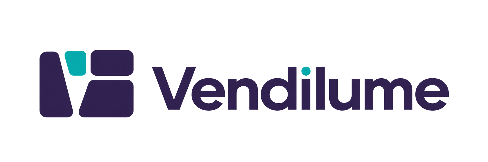
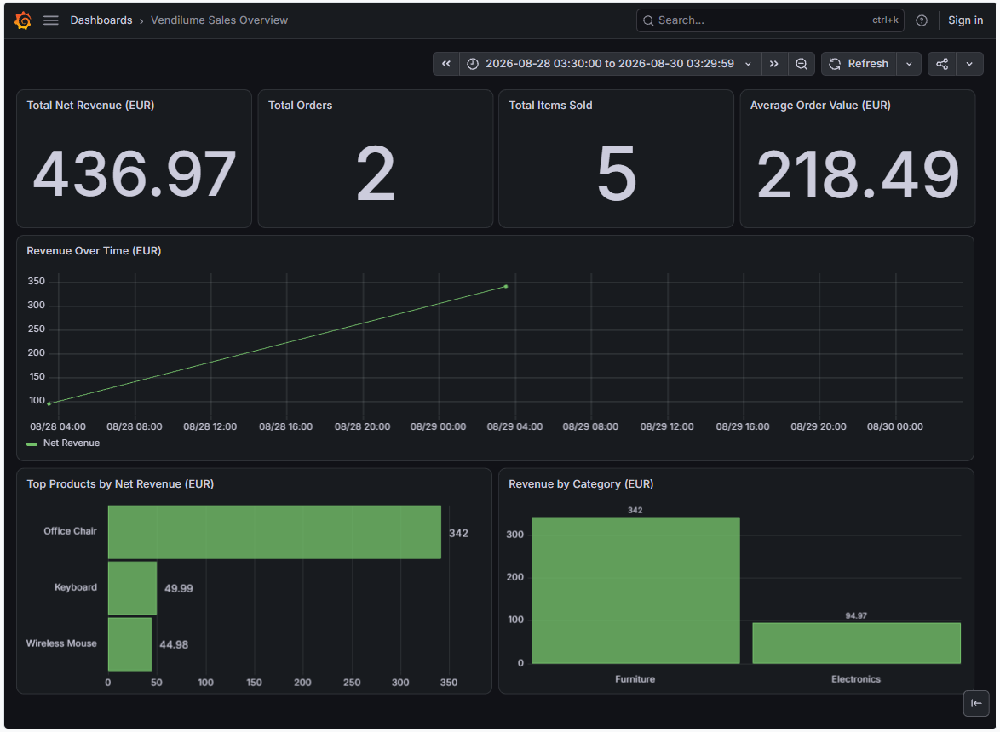
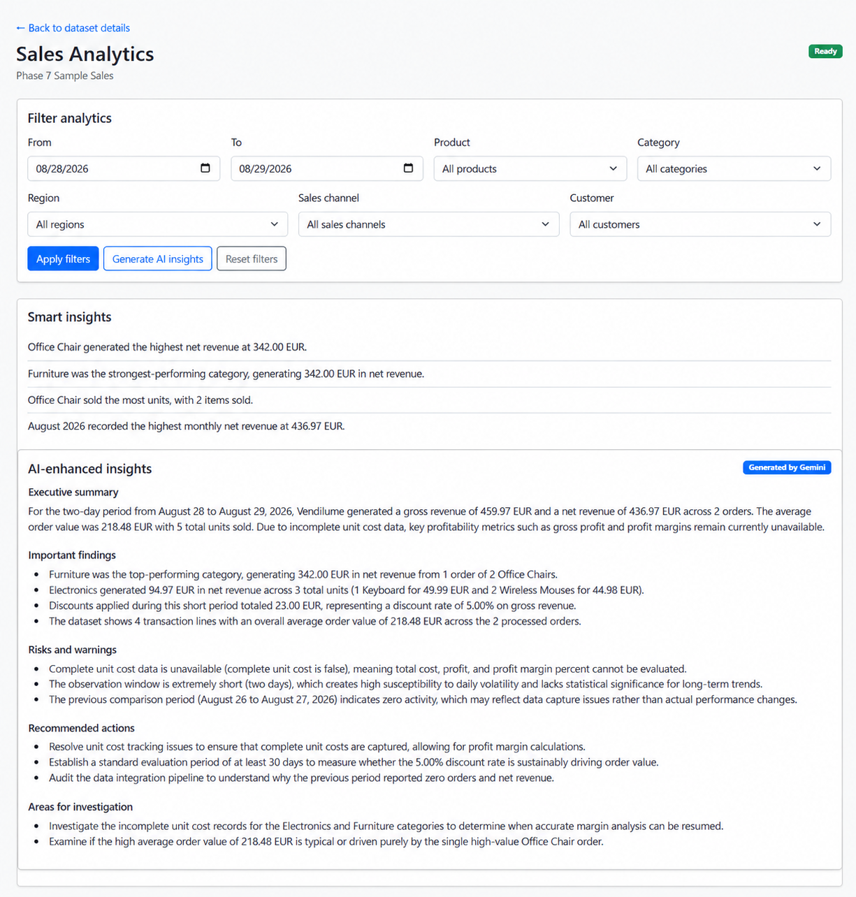
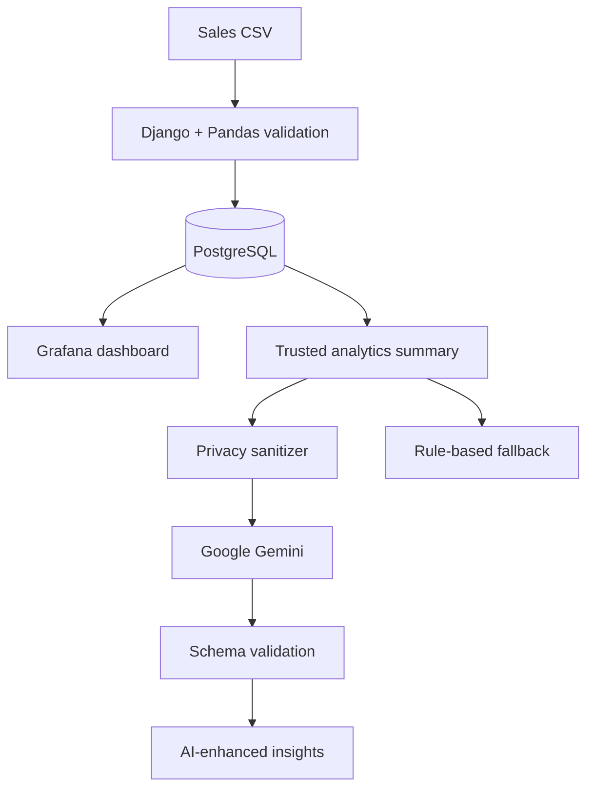

<p align="center">
  
</p>

<p align="center">
  <strong>From raw sales data to trusted dashboards, business explanations, and practical next steps.</strong>
</p>

<p align="center">
  <a href="https://www.python.org/"></a>
  <a href="https://www.djangoproject.com/"></a>
  <a href="https://www.postgresql.org/"></a>
  <a href="https://grafana.com/"></a>
  <a href="https://ai.google.dev/"></a>
  
  <a href="LICENSE"></a>
</p>

<p align="center">
  <a href="#why-vendilume">Why Vendilume?</a> •
  <a href="#key-features">Features</a> •
  <a href="#how-it-works">Workflow</a> •
  <a href="#getting-started">Getting Started</a> •
  <a href="#development-roadmap">Roadmap</a>
</p>

---

<p align="center">
  
</p>

## Why Vendilume?

Sales data is useful only when a business can trust the calculations, understand what changed, and decide what to do next. Vendilume brings that process into one focused workflow:

1. Upload a sales CSV.
2. Validate, clean, and persist the data.
3. Explore trusted KPIs and trends in Grafana.
4. Apply synchronized business filters.
5. Review deterministic findings and optional AI-enhanced recommendations.

Unlike a generic chatbot attached to raw data, Vendilume calculates authoritative metrics itself. Google Gemini receives a controlled analytics summary and acts only as an interpretation layer.

## Key Features

| Data pipeline | Business intelligence | Decision support |
| --- | --- | --- |
| CSV structure and value validation | Dataset-scoped Grafana dashboard | Deterministic Smart Insights |
| Cleaning and calculated financial fields | Revenue, orders, quantity, and AOV KPIs | Structured Gemini explanations |
| Atomic PostgreSQL persistence | Product, category, and monthly trends | Risks and measurable actions |
| Dataset history and management | Synchronized multi-dimensional filters | Privacy sanitization and fallback behavior |

### Built and verified

- All-or-nothing CSV ingestion with clear validation feedback
- Dataset, date, product, category, region, sales-channel, and customer filters
- Seven Grafana panels driven by the same validated filter state as Django
- Trusted summaries containing KPIs, rankings, trends, comparisons, and discount behavior
- Five-part AI output: executive summary, findings, risks, actions, and investigation areas
- Strict response validation, a controlled timeout, and deterministic fallback
- Authenticated employee accounts with password-management and session-expiration behavior
- Administrator, Sales Analyst, and Manager roles enforced in views and reflected in the interface
- Administrator-managed employee accounts with no unrestricted public signup
- **136 automated tests**, with external API behavior mocked during the test suite

## AI-Enhanced Business Insights

<p align="center">
  
</p>

Vendilume does not ask the AI model to calculate business KPIs. The application first builds a versioned summary from verified database queries, then removes internal dataset identifiers and customer identifiers before creating the external prompt.

The AI response is accepted only if it matches Vendilume's strict schema. If Gemini is unavailable, misconfigured, times out, returns invalid content, or has no matching data to interpret, the existing rule-based Smart Insights remain available.

> [!IMPORTANT]
> AI recommendations are explanatory guidance, not authoritative calculations. Vendilume's stored data, calculated metrics, and deterministic findings remain the source of truth.

## How It Works



### Responsibility boundaries

| Component | Responsibility |
| --- | --- |
| **Django** | Application workflow, forms, views, filters, and error states |
| **Pandas** | CSV parsing, validation, cleaning, and transformation |
| **PostgreSQL** | Persistent sales storage and the read-only analytics view |
| **Grafana** | Interactive KPI and sales-performance visualization |
| **Vendilume analytics services** | Authoritative calculations, rankings, trends, and comparisons |
| **Google Gemini** | Optional interpretation of the sanitized trusted summary |

## Technology Stack

| Technology | Role |
| --- | --- |
| Python 3.13 | Primary programming language |
| Django 5.2 | Server-rendered web application and backend |
| Pandas | Dataset processing and transformation |
| PostgreSQL | Persistent relational storage and analytics view |
| Grafana | Embedded analytics dashboard |
| Google Gemini API | Structured business-insight interpretation |
| Bootstrap | Responsive interface components |
| Git and GitHub | Version control and project history |

More detail is available in [`docs/TECHNOLOGY_STACK.md`](docs/TECHNOLOGY_STACK.md).

## Getting Started

### Prerequisites

- Python 3.13
- PostgreSQL
- Grafana
- Git
- A Gemini API key only if AI-enhanced insights are required

### 1. Clone and prepare the project

```bash
git clone https://github.com/Sephernie/Vendilume.git
cd Vendilume
python -m venv .venv
```

Activate the environment:

```powershell
# Windows PowerShell
.\.venv\Scripts\Activate.ps1
```

```bash
# macOS or Linux
source .venv/bin/activate
```

Install the dependencies:

```bash
python -m pip install -r requirements.txt
```

### 2. Configure the environment

Copy `.env.example` to `.env`, then replace its placeholder values:

```powershell
Copy-Item .env.example .env
```

```bash
cp .env.example .env
```

The local configuration includes Django, PostgreSQL, and Grafana settings. Gemini is optional:

```dotenv
GEMINI_API_KEY=
GEMINI_MODEL=gemini-3.5-flash
```

Leave `GEMINI_API_KEY` blank to use deterministic Smart Insights without making external AI requests. Never commit the real `.env` file or an API key.

### 3. Initialize Django

### 3. Initialize Django

After creating the configured PostgreSQL database and role, initialize the database and Vendilume access roles:

```bash
python manage.py migrate
python manage.py setup_roles
python manage.py createsuperuser
python manage.py check
python manage.py runserver
```

The initial superuser manages employee accounts through Django Admin. Assign that account to the **Administrators** group to record its intended Vendilume role explicitly.

Additional employee accounts can then be created through **Manage Users** and assigned to one of the following groups:

- **Administrators** — manage datasets, users, and roles
- **Sales Analysts** — upload, review, and delete datasets and access analytics
- **Managers** — review datasets and analytics without upload or deletion access

Vendilume does not provide public account registration.

Open `http://127.0.0.1:8000/accounts/login/` and sign in with the administrator account.

### 4. Configure Grafana

Import [`grafana/dashboards/vendilume-sales-overview.json`](grafana/dashboards/vendilume-sales-overview.json) into Grafana, connect it to the Vendilume PostgreSQL analytics view through a read-only database account, and place the resulting dashboard UID in `.env`.

## Testing

Run the complete test suite locally:

```bash
python manage.py test
python manage.py makemigrations --check --dry-run
```

The current suite contains **136 tests** covering CSV validation, transactional persistence, database constraints, authenticated views, role permissions, direct-URL restrictions, role-aware interface behavior, administrator account management, Grafana integration, filters, trusted analytics calculations, privacy sanitization, Gemini response validation, timeout behavior, and fallback paths. Tests do not make live Gemini requests.

## Privacy, Reliability, and Limitations

- The original CSV is never sent to Gemini.
- Dataset names, internal dataset IDs, and customer identifiers are removed from the AI prompt.
- Product, category, region, and sales-channel values may be included when needed for interpretation.
- AI generation occurs only after the user explicitly requests it.
- Provider errors and invalid responses fall back to deterministic Smart Insights.
- Usage remains subject to the configured provider's availability and quota.
- AI explanations can be incomplete or imperfect and should be reviewed alongside the verified metrics.

## Development Roadmap

Vendilume began with a twelve-phase roadmap. The original MVP was completed through Phase 10 and preserved as the Git tag [`v0.1-mvp`](https://github.com/Sephernie/Vendilume/tree/v0.1-mvp). Three post-MVP product phases were then inserted before final testing and documentation.

| Phase | Scope | Status |
| ---: | --- | :---: |
| 1–9 | Foundation through Django–Grafana integration | Complete |
| 10 | Filters and Smart Insights | Complete |
| 11 | AI-Enhanced Business Insights **[New]** | **Complete** |
| 12 | User Accounts and Role-Based Access Control **[New]** | **Complete** |
| 13 | Vendilume UI/UX Redesign **[New]** | **Next** |
| 14 | Testing, Security and Final Polish *(original Phase 11)* | Planned |
| 15 | Final Documentation and Presentation *(original Phase 12)* | Planned |

The full plan and revision history are preserved in [`docs/PROJECT_PLAN.md`](docs/PROJECT_PLAN.md).

## Repository Structure

```text
Vendilume/
├── accounts/                       # Authentication, company roles, and user-management tests
├── config/                         # Django configuration
├── core/                           # Shared pages and navigation
├── datasets/
│   ├── migrations/                # Database schema and analytics view
│   ├── services/
│   │   ├── ai_insights.py         # Prompt and response contracts
│   │   ├── analytics_insights.py  # Deterministic findings
│   │   ├── analytics_summary.py   # Trusted analytics summary
│   │   ├── business_insights.py   # AI/fallback orchestration
│   │   ├── csv_processor.py       # CSV validation and transformation
│   │   ├── dataset_importer.py    # Atomic persistence
│   │   └── gemini_provider.py     # Gemini adapter
│   ├── templates/                 # Dataset-facing pages
│   ├── forms.py
│   ├── models.py
│   ├── tests.py
│   └── views.py
├── docs/                           # Project and design documentation
├── grafana/dashboards/             # Version-controlled dashboard JSON
├── templates/                      # Shared Django templates
├── .env.example
├── manage.py
└── requirements.txt
```

## Documentation

| Document | Description |
| --- | --- |
| [`PROJECT_OVERVIEW.md`](docs/PROJECT_OVERVIEW.md) | Purpose, objectives, users, and scope |
| [`REQUIREMENTS.md`](docs/REQUIREMENTS.md) | Functional and non-functional requirements |
| [`TECHNOLOGY_STACK.md`](docs/TECHNOLOGY_STACK.md) | Technology responsibilities and rationale |
| [`PROJECT_PLAN.md`](docs/PROJECT_PLAN.md) | Development phases and roadmap history |
| [`DATA_SPECIFICATION.md`](docs/DATA_SPECIFICATION.md) | Supported CSV contract and calculated fields |
| [`SYSTEM_DESIGN.md`](docs/SYSTEM_DESIGN.md) | Architecture, responsibilities, and interactions |
| [`DATABASE_DESIGN.md`](docs/DATABASE_DESIGN.md) | PostgreSQL schema, constraints, and analytics view |

## Project Scope

Vendilume focuses on the workflow between **sales-data import and sales-performance analysis**. It is not intended to replace a complete ERP, e-commerce platform, or enterprise-wide BI platform.

## Author

**Sepehr Bakhshivash** — aspiring Data Analyst / Data Scientist

[](https://www.linkedin.com/in/sepehr-bakhshivash)
[](https://github.com/Sephernie)

## License

This project is licensed under the terms provided in [`LICENSE`](LICENSE).
