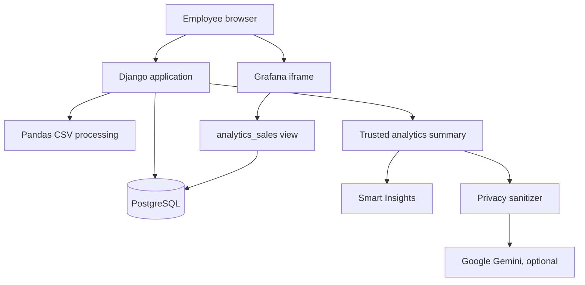

# Vendilume Current Architecture

This document describes the implemented application at the Phase 14 checkpoint. The earlier [system design](SYSTEM_DESIGN.md), [requirements](REQUIREMENTS.md), and [technology selection](TECHNOLOGY_STACK.md) preserve the original MVP decisions. The [project plan](PROJECT_PLAN.md) records the later phases.

## System boundary

Vendilume is a locally operated Django application. Employees sign in through Django. Django handles uploads, dataset management, filtering, authoritative calculations, and insight display. Pandas validates and transforms a whole CSV before an atomic PostgreSQL import. A PostgreSQL view named `analytics_sales` exposes ready sales data to a separate Grafana account with read access. Grafana renders seven embedded dashboard panels.

The browser does not query PostgreSQL directly. Django and Grafana use different database accounts. The original uploaded CSV is not the authoritative long term store; committed structured records are.

## Access model

The application has no public signup. An administrator creates employee accounts and assigns one role through Django groups. `setup_roles` creates or refreshes the groups and permissions.

| Role | Dataset access | Administration |
| --- | --- | --- |
| Administrators | Upload, view, and delete | Manage users and groups |
| Sales Analysts | Upload, view, and delete | None |
| Managers | View datasets and analytics | None |

The application enforces permissions in views as well as navigation. Sessions expire on browser close or after 15 minutes of inactivity. In the reviewed single-computer deployment, Grafana listens only on loopback and its anonymous account has Viewer permissions so the iframe can display without another sign-in. This Grafana arrangement must be redesigned for shared-network or public deployment.

## Data and analytics flow

1. An authorized employee uploads a CSV and selects a currency. Vendilume validates required columns, values, and cross-row consistency before writing data.
2. Django imports the dataset, orders, and sales lines in one database transaction. Failed imports do not leave partial datasets ready for analysis.
3. The analytics page validates the dataset and date, product, category, and available optional filters. Django constructs one filter state for the trusted summary and Grafana URL.
4. Grafana queries `analytics_sales` using the selected dataset ID. Django calculates KPIs and deterministic Smart Insights from stored data independently of Grafana rendering.
5. On an explicit request, Vendilume sanitizes the trusted summary and asks Gemini to interpret it. Dataset names, internal dataset IDs, and customer identifiers are removed from the external prompt. A strict response contract protects the display. If the provider fails or responds with invalid data, rule-based Smart Insights remain visible.

Gemini is an interpretation layer. It does not compute the authoritative metrics. The application does not require a Gemini key for its core workflow.

## Local components and repository map

| Component | Source | Responsibility |
| --- | --- | --- |
| Django settings and routing | `config/`, `accounts/` | Environment, authentication, roles, sessions |
| Upload and data services | `datasets/forms.py`, `datasets/services/csv_processor.py`, `dataset_importer.py` | CSV contract, validation, atomic import |
| Database schema and view | `datasets/models.py`, `datasets/migrations/` | Structured storage and `analytics_sales` |
| Analytics and AI services | `datasets/services/analytics_summary.py`, `analytics_insights.py`, `business_insights.py`, `ai_insights.py`, `gemini_provider.py` | Trusted calculations, deterministic and optional AI insights |
| Presentation | `core/`, `accounts/templates/`, `datasets/templates/`, `templates/` | Responsive web interface |
| Dashboard | `grafana/dashboards/vendilume-sales-overview.json` | Seven PostgreSQL-backed panels |

The repository contains no Docker Compose definition. The documented installation runs Python, PostgreSQL, and Grafana as local services. See [Local Setup](LOCAL_SETUP.md).

## Verification and limits

Phase 14 recorded 154 passing automated tests, 96% application-code coverage, a clean Django system check, no migration drift, and manual checks at mobile, tablet, desktop, keyboard navigation, and 200% zoom. These are checkpoint results, not a claim that this archive was tested against a newly configured machine.

Current scope is CSV import and sales analysis for a locally operated installation. It does not include a production HTTPS proxy, network-wide Grafana authorization, or a deployment package. Local development settings should not be copied unchanged to a public server.
